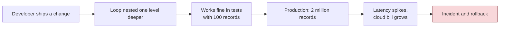
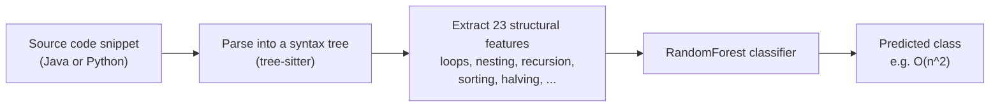
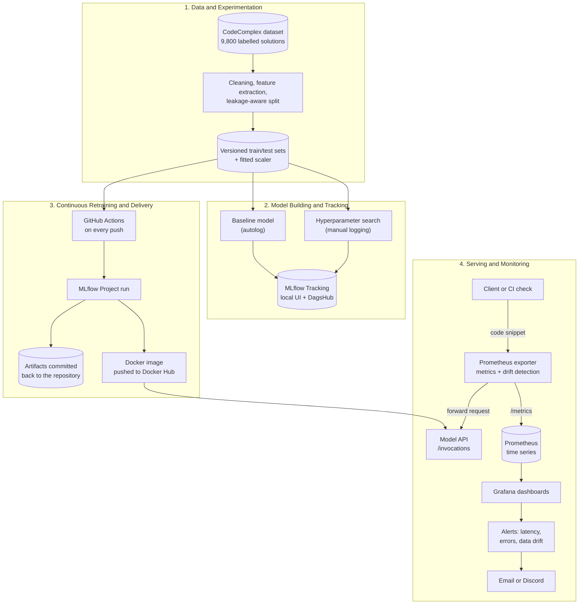
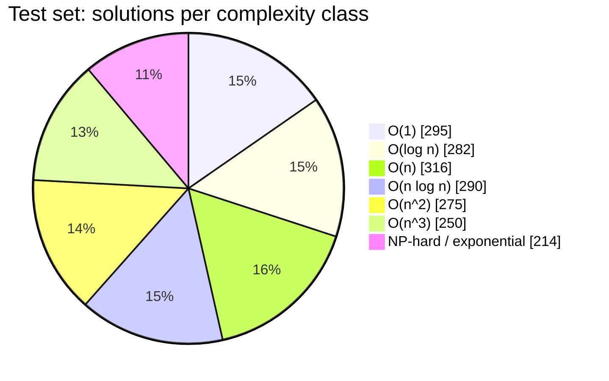
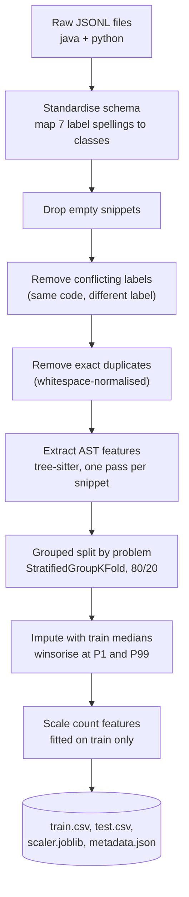
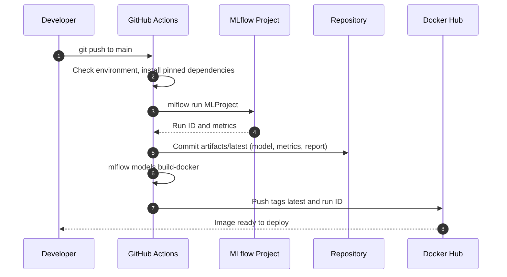
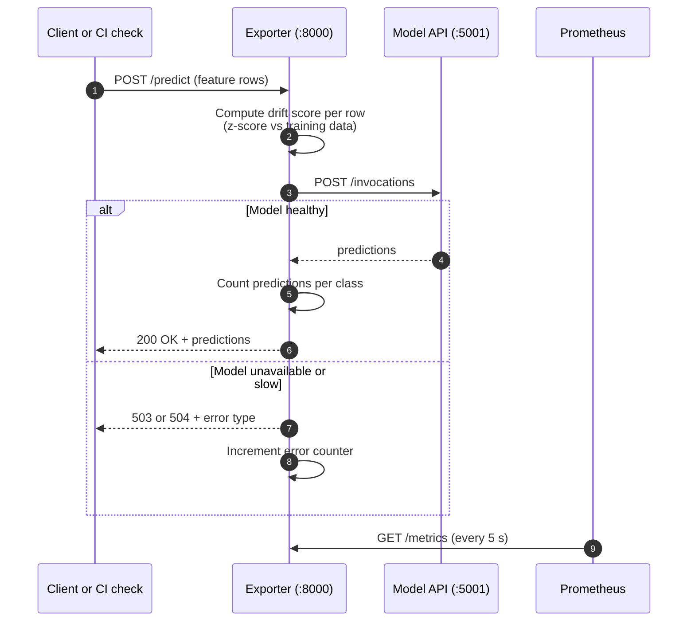
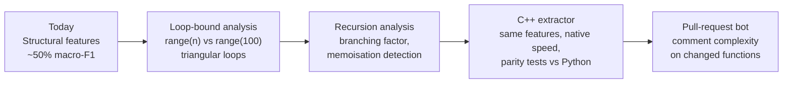

# BigOracle: Predicting Algorithmic Complexity from Source Code

> A "performance linter" for backend teams. BigOracle reads a code snippet, predicts its worst-case time complexity (O(1) up to NP-hard) **without running it**, and streams the results into a monitored, continuously retrained ML service.

---

## Table of Contents

1. [Executive Summary](#1-executive-summary)
2. [The Problem and Why It Matters](#2-the-problem-and-why-it-matters)
3. [How It Works (for Everyone)](#3-how-it-works-for-everyone)
4. [System Architecture](#4-system-architecture)
5. [Results at a Glance](#5-results-at-a-glance)
6. [Data Pipeline](#6-data-pipeline)
7. [Modelling and Experiments](#7-modelling-and-experiments)
8. [MLOps: Tracking, CI, and Delivery](#8-mlops-tracking-ci-and-delivery)
9. [Serving and Monitoring](#9-serving-and-monitoring)
10. [Repository Layout](#10-repository-layout)
11. [Quick Start](#11-quick-start)
12. [Key Engineering Decisions](#12-key-engineering-decisions)
13. [Limitations and Honest Assessment](#13-limitations-and-honest-assessment)
14. [Roadmap](#14-roadmap)
15. [Tech Stack](#15-tech-stack)
16. [References and Acknowledgements](#16-references-and-acknowledgements)
17. [Author](#17-author)

---

## 1. Executive Summary

Performance regressions usually surface only after deployment, when a loop that was linear becomes quadratic and latency climbs. BigOracle moves that detection to the moment code is written.

|                         |                                                                                                                                           |
| ----------------------- | ----------------------------------------------------------------------------------------------------------------------------------------- |
| **What it does**        | Classifies a code snippet into one of 7 worst-case complexity classes, with a confidence signal                                           |
| **Who it is for**       | Backend and platform teams that want early warnings in code review or CI                                                                  |
| **How it is delivered** | A reproducible ML pipeline: versioned data, tracked experiments, automated retraining, a container image, and live monitoring with alerts |
| **Current maturity**    | Working end-to-end prototype. Predictions are useful for triage, not yet reliable enough to block a merge on their own                    |

**Why this project is interesting beyond the model:** it covers the full lifecycle a production ML system needs, from data cleaning and leakage-aware evaluation, through experiment tracking, CI-driven retraining and containerisation, to monitoring that detects data drift and fires alerts.

---

## 2. The Problem and Why It Matters



Most of these problems are invisible to unit tests, because tests use small inputs. A static signal that says _"this function looks O(n²)"_ during review is cheap to act on and expensive to ignore.

**Business value, in plain terms**

- **Fewer performance incidents** caught at review time, when fixing them costs minutes instead of days.
- **Lower infrastructure cost** from avoiding accidental quadratic behaviour in hot paths.
- **Consistent review standards** across teams, without relying on one senior engineer to spot every nested loop.

---

## 3. How It Works (for Everyone)

BigOracle does not execute code. It reads the code's _shape_: how many loops, how deeply they nest, whether the function calls itself, whether it sorts, halves its input, or uses a hash map. A trained model turns that shape into a complexity estimate.



**Example.** A nested loop over the same array produces a high `max_loop_depth` and `for_count`, which the model associates with polynomial classes. A snippet that halves its input each iteration produces `has_halving`, which the model associates with logarithmic classes.

---

## 4. System Architecture

The project has four stages. Each stage is reproducible on its own, and each produces an artifact the next stage consumes.



---

## 5. Results at a Glance

All numbers below are measured on a held-out test set of **54 problems the model never saw during training**. Splitting by problem, not by row, is what makes these numbers honest (see [Section 7](#7-modelling-and-experiments)).

| Metric                                       | Value                            | Context                                                         |
| -------------------------------------------- | -------------------------------- | --------------------------------------------------------------- |
| Test accuracy                                | **0.51**                         | Baseline RandomForest, default settings                         |
| Test macro-F1                                | **0.50**                         | Treats all 7 classes equally, which matters for imbalanced data |
| Random chance                                | ~0.14                            | Uniform guessing across 7 classes                               |
| Best class F1                                | **0.68** (O(1))                  | Constant-time code has clear structural signals                 |
| Hardest class F1                             | **0.28** (NP-hard / exponential) | Often confused with ordinary recursion                          |
| Tuned model (grid search, 3-fold grouped CV) | `<fill from grid_results.csv>`   | Selected on cross-validation, not on the test set               |
| Inference throughput                         | `<fill from load test>`          | Measured on the exporter pipeline                               |

**Test set class distribution** (1,922 solutions across 54 problems):



**Reading the per-class results.** Classes with distinctive structure (constant, logarithmic, and `sort`-based O(n log n)) score well. Polynomial classes that differ only in loop depth score lower, because the true bound depends on input constraints that are not visible in the code's shape. This is a known limit of structural features, and it points directly at the roadmap.

---

## 6. Data Pipeline

**Dataset.** [CodeComplex](https://github.com/sybaik1/CodeComplex) (Baik et al., 2024): competitive-programming solutions in Java and Python, each labelled with its worst-case time complexity.



| Step                        | Result                            |
| --------------------------- | --------------------------------- |
| Raw samples                 | 9,800                             |
| Removed: conflicting labels | 133                               |
| Removed: exact duplicates   | 283                               |
| **Clean samples**           | **9,384**                         |
| Training set                | 7,462 solutions from 246 problems |
| Test set                    | 1,922 solutions from 54 problems  |

**Feature set (23 features).** Size (lines, characters, AST nodes and depth), loops (count by type, maximum nesting), branching, function and call structure, recursion depth, and lexical algorithm patterns: sorting, halving, doubling, binary search, heaps, hash containers, memoisation. Every feature is computed in a single traversal of the syntax tree.

---

## 7. Modelling and Experiments

### 7.1 The evaluation decision that matters most

Solutions to the same problem look alike. If rows are split randomly, the model can recognise _the problem_ rather than learn _the complexity_, and scores look better than they should.

| Evaluation strategy          | Test macro-F1 | Interpretation                                                |
| ---------------------------- | ------------- | ------------------------------------------------------------- |
| Random row-level split       | ~0.67         | **Inflated**: the same problems appear in train and test      |
| **Grouped split by problem** | **0.50**      | **Honest**: the model is tested on problems it has never seen |

The pipeline enforces this with an assertion that no problem appears on both sides, and cross-validation during tuning also groups by problem. A lower number that survives scrutiny is worth more than a higher number that does not.

### 7.2 Baseline

A RandomForest with default settings and MLflow autologging. It establishes the reference point every later change must beat.

### 7.3 Hyperparameter tuning

A grid over `n_estimators`, `max_depth`, and `min_samples_leaf`, selected by macro-F1 on grouped cross-validation over the training data. The test set is touched only once, to report the final numbers.

| Run                | Selection metric     | Test macro-F1 |
| ------------------ | -------------------- | ------------- |
| Baseline (default) | n/a                  | 0.50          |
| Grid search best   | CV macro-F1 `<fill>` | `<fill>`      |

### 7.4 What limits performance

Structural features capture _how code is shaped_, not _how its loop bounds behave_. Concretely, the model cannot yet tell `for i in range(n)` from `for i in range(100)`, or detect a triangular loop (`for j in range(i)`), or measure whether recursion branches once or twice. These are the highest-value feature additions (see [Roadmap](#14-roadmap)).

---

## 8. MLOps: Tracking, CI, and Delivery

### 8.1 Experiment tracking

Every training run logs parameters, metrics, confusion matrices, feature importances, and the serialised model to MLflow. Two tracking backends are used:

- **Local MLflow server** for fast iteration.
- **DagsHub** for a shared, online record of the same experiments.

### 8.2 Continuous integration

A push to `main` (or a manual trigger) runs the training pipeline in GitHub Actions, commits the resulting artifacts back to the repository, and publishes a container image.



Every image is tagged with the MLflow run ID, so any deployed model can be traced back to the exact data, parameters, and code that produced it.

### 8.3 Reproducibility

- Pinned dependency versions in `requirements.txt` and `conda.yaml`.
- Fixed random seeds throughout.
- Preprocessing metadata (medians, clipping bounds, class mapping, split scheme) saved alongside the model.
- A notebook and a script that produce byte-identical outputs, checked by an automated comparison.

---

## 9. Serving and Monitoring

### 9.1 Request lifecycle

Every prediction passes through an exporter that measures latency, validates input, and checks whether the input looks like the training data.



### 9.2 Drift detection

For each input row, BigOracle computes the average absolute z-score of its 14 continuous features relative to the training distribution.

- Normal held-out rows score at most **3.99**.
- Rows deliberately shifted by 15 to 40 standard deviations score **above 21**.
- Rows above **4.0** are flagged as out-of-distribution (OOD).

This gives a simple, explainable early warning: if production code starts to look nothing like the training corpus, the model's predictions should not be trusted without review.

### 9.3 Metrics exposed

The exporter publishes 17 metric families:

| Area           | Metrics                                                                                          |
| -------------- | ------------------------------------------------------------------------------------------------ |
| Traffic        | `requests_total` (by status), `requests_in_progress`, `batch_size_rows`, `request_payload_bytes` |
| Performance    | `request_latency_seconds` (histogram), `model_inference_seconds` (histogram), `uptime_seconds`   |
| Quality        | `errors_total` (by type), `predictions_total` (by class)                                         |
| Data drift     | `input_drift_score`, `input_drift_score_rolling`, `input_rows_total`, `ood_rows_total`           |
| Infrastructure | `model_up`, `cpu_usage_percent`, `memory_usage_percent`, `process_memory_bytes`                  |

### 9.4 Alerts

| Alert                | Condition                                | Business meaning                                                                            |
| -------------------- | ---------------------------------------- | ------------------------------------------------------------------------------------------- |
| High request latency | p95 > 0.5 s for 30 s                     | Users or CI checks are waiting too long                                                     |
| High error ratio     | More than 20% of requests fail for 30 s  | The service is broken or receiving invalid input                                            |
| Input drift          | More than 30% of inputs are OOD for 30 s | The model is being asked about code it was not trained on, so predictions may be unreliable |

Alerts are delivered by email (and optionally Discord), and each one is designed to be triggered in a controlled way during testing.

### 9.5 Dashboard

A single Grafana dashboard with 17 panels covering throughput, latency, predictions per class, drift, errors, batch size, payload size, CPU, and memory.

---

## 10. Repository Layout

```
BigOracle/
├── Eksperimen_SML_<name>/        # data preparation and exploration
│   ├── codecomplex_raw/          # raw dataset (JSONL)
│   └── preprocessing/
│       ├── Eksperimen_<name>.ipynb   # exploratory notebook: EDA and preprocessing
│       ├── automate_<name>.py        # same steps, as a reusable function
│       └── codecomplex_preprocessing/ # train/test sets, scaler, metadata
├── Membangun_model/              # model training and tracking
│   ├── modelling.py              # baseline with autologging
│   ├── modelling_tuning.py       # grid search with manual logging, local + DagsHub
│   └── requirements.txt
├── Workflow-CI/                  # continuous retraining and delivery
│   ├── .github/workflows/ci.yml  # GitHub Actions pipeline
│   ├── MLProject/                # MLflow Project (entry point, environment, script)
│   └── scripts/ci_utils.py       # run lookup and artifact collection
└── Monitoring dan Logging/       # serving, monitoring, and alerting
    ├── 3.prometheus_exporter.py  # metrics, drift detection, request proxy
    ├── 7.inference.py            # traffic generator (normal, drift, error, slow, mixed)
    ├── build_dashboard.py        # Grafana dashboard generator
    ├── docker-compose.yml        # Prometheus and Grafana
    └── grafana/                  # provisioning and dashboard definitions
```

---

## 11. Quick Start

Requirements: Python 3.12, Docker Desktop (for the image and the monitoring stack).

**1. Prepare data and train (baseline and tuning)**

```bash
cd Eksperimen_SML_<name>
python preprocessing/automate_<name>.py          # produces the processed dataset

cd ../Membangun_model
pip install -r requirements.txt
mlflow ui --backend-store-uri sqlite:///mlflow.db --port 5001 &
python modelling.py                              # baseline, autologged
python modelling_tuning.py                       # grid search, local + DagsHub
```

**2. Reproduce the CI run**

```bash
cd ../Workflow-CI
export MLFLOW_TRACKING_URI="sqlite:///$PWD/mlflow.db"
mlflow run MLProject --env-manager=local --experiment-name BigOracle_CI
```

**3. Serve the model**

```bash
mlflow models serve -m artifacts/latest/model -p 5001 --host 127.0.0.1 --env-manager local
curl -s -X POST http://127.0.0.1:5001/invocations \
     -H "Content-Type: application/json" \
     -d @artifacts/latest/model/serving_input_example.json
```

**4. Start monitoring**

```bash
cd "../Monitoring dan Logging"
python 3.prometheus_exporter.py                  # exporter on :8000
docker compose up -d                             # Prometheus :9090, Grafana :3000
python 7.inference.py --mode mixed --duration 600
```

Open Grafana at `http://127.0.0.1:3000`, import `grafana/dashboards/bigoracle.json`, and watch the panels fill. To trigger an alert, run `7.inference.py --mode drift` or `--mode slow` for two to three minutes.

---

## 12. Key Engineering Decisions

| Decision                             | Why                                                                          | Trade-off accepted                                      |
| ------------------------------------ | ---------------------------------------------------------------------------- | ------------------------------------------------------- |
| Split by problem, not by row         | Prevents leakage; measures generalisation to new problems                    | Lower reported scores; smaller test set (54 groups)     |
| Tree-sitter for parsing              | One consistent parser for two languages; fast; error-tolerant                | Java and Python only for now                            |
| Lexical pattern features             | Cheap, interpretable, captures sorting and halving                           | Can misfire (e.g. `/ 2` unrelated to binary search)     |
| Percentile clipping, not IQR         | Count features are mostly zero, so IQR collapses and flags nearly everything | Fixed percentile bounds need occasional review          |
| Statistics fitted on train only      | No information from test leaks into preprocessing                            | Slightly more code                                      |
| Exporter in front of the model       | Measures latency and drift without changing the model server                 | One extra hop per request                               |
| Commit artifacts to the repo from CI | Every model version is inspectable without a separate store                  | Repository grows with each run                          |
| SQLite-backed MLflow locally         | Works with MLflow 3.x without a separate server                              | Not suitable for multi-user use; DagsHub covers sharing |

---

## 13. Limitations and Honest Assessment

- **Accuracy is moderate (about 50%).** BigOracle is best used as a triage signal: it flags code worth a closer look, not a verdict. It should not block a merge on its own yet.
- **The model cannot reason about input sizes.** Loop bounds that depend on constraints (`n`, `len(a)`, a fixed constant) look the same to the current features.
- **Lexical patterns can misfire.** A division by two is not always a binary search.
- **Small test set.** 54 problems give a reasonable but noisy estimate. Grouped cross-validation is the better long-term measure.
- **Two languages only.** C++, which motivated the project, is not yet supported.
- **Monitoring is validated locally.** Metrics, drift detection, and alert logic were tested end to end, but production-scale load testing is still to do.

Naming these limits explicitly is deliberate. A model whose weaknesses are measured and documented is easier to trust, and easier to improve, than one presented without them.

---

## 14. Roadmap



1. **Richer features.** Loop-bound analysis and recursion analysis target the classes the model confuses today.
2. **C++ feature extractor.** A native implementation benchmarked against the Python reference, with tests that check both produce identical features.
3. **Pull-request integration.** A bot that comments on changed functions, with the drift and confidence signals attached.
4. **Deployment.** Multi-architecture images and a Kubernetes manifest, so the same image runs on Apple Silicon and x86 servers.

---

## 15. Tech Stack

| Area                | Tools                                                     |
| ------------------- | --------------------------------------------------------- |
| Language and data   | Python 3.12, pandas, NumPy                                |
| Parsing             | tree-sitter (Java and Python grammars)                    |
| Machine learning    | scikit-learn (RandomForest, StratifiedGroupKFold), joblib |
| Experiment tracking | MLflow 3.x, DagsHub                                       |
| CI/CD               | GitHub Actions, MLflow Projects, Docker Hub               |
| Serving             | MLflow model server, Docker                               |
| Monitoring          | Prometheus, Grafana, prometheus-client, Flask, psutil     |
| Alerting            | Grafana alerting with email (and Discord) contact points  |

---

## 16. References and Acknowledgements

- Baik, S.-Y. et al. (2024). _CodeComplex: Dataset for Worst-Case Time Complexity Prediction._ arXiv:2401.08719. Dataset: https://github.com/sybaik1/CodeComplex
- Open-source projects: MLflow, scikit-learn, tree-sitter, Prometheus, Grafana, and the Python scientific stack.

---

## 17. Author

**`Bryan Noel`**, software engineer, Singapore
